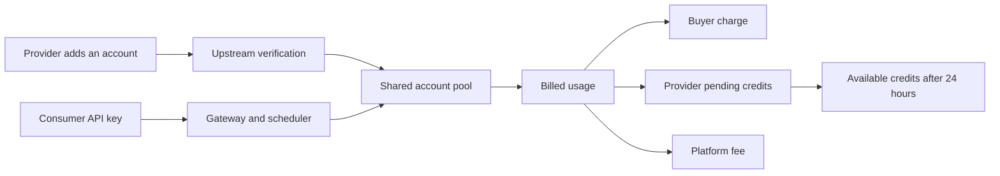

<div align="center">
  
  <h1>TokenC2C</h1>
  <p><strong>Shared accounts. Real demand. Clear accounting.</strong></p>
  <p>A self-hosted, community-powered AI account pool with buyer and provider accounting.</p>

  <p>
    <a href="README.md"><strong>English</strong></a> ·
    <a href="README_CN.md">简体中文</a> ·
    <a href="README_JA.md">日本語</a>
  </p>

  
  
  
  
  <a href="LICENSE"></a>
</div>

## Overview

TokenC2C extends [Sub2API](https://github.com/Wei-Shaw/sub2api) with a user-owned supply layer. Providers add their own supported upstream accounts; verified accounts become eligible for the shared scheduler. Consumers call AI services with their own platform API keys. The platform tracks both the buyer's usage and the provider's earnings.

One user can be both a consumer and a provider. **Token** refers to AI usage units and platform credits, not a cryptocurrency.

## Features

- **Self-service supply:** add, verify, pause, resume and remove your own provider accounts.
- **Verified entry:** accounts remain unschedulable until verification succeeds.
- **Shared scheduling:** reuse Sub2API's authentication, routing, rate limits and usage billing.
- **Supply controls:** optional daily contribution limits and per-account pool status.
- **Two-sided accounting:** request counts, Token totals, buyer spending and provider earnings through the C2C API; wallet, account and ledger views in the dashboard.
- **Atomic settlement:** buyer charges, provider credits and platform fees are recorded in one database transaction.
- **Duplicate protection:** request/API-key identifiers and ledger idempotency keys prevent repeated settlement.
- **Responsive experience:** original TokenC2C branding and an English/Chinese landing page. Documentation is available in English, Chinese and Japanese.

### What TokenC2C adds

| Area | Inherited Sub2API foundation | TokenC2C extension |
| --- | --- | --- |
| Account management | Administrator-managed upstream accounts | User-owned accounts with self-service verification and supply controls |
| Routing | Shared upstream scheduler and API gateway | Verified user contributions participate in scheduling |
| Billing | Consumer usage and balance charging | Provider earnings, platform fees and pending-credit settlement |
| Visibility | Usage records and management dashboards | Separate buyer/provider totals and a settlement ledger |

## How it works



### Current accounting rules

| Item | Rule |
| --- | --- |
| Provider share | 90% of the buyer's billed amount, as platform credits |
| Platform fee | 10% of the buyer's billed amount |
| Pending period | 24 hours before provider credits become available |
| Self-consumption | Supported; the same accounting and platform fee apply |
| Cash withdrawals | Not implemented |

These are the current MVP rules in the code, not a guaranteed return. Earnings require actual scheduled and billed usage. Automated refunds, dispute resolution and cash payouts are not part of this version.

## Supported account sources

The C2C form supports OpenAI, Anthropic, Gemini, Antigravity, Grok, Kimi, Zhipu/GLM and DeepSeek. Available credential types vary by provider; use the choices shown in the account form. Actual model access depends on the account and operator configuration.

The C2C contribution flow accepts supported official upstreams. User-defined base URLs and generic relay account types are rejected. Buyers use their own platform API keys; upstream credentials are not returned by account-list or statistics APIs.

## Quick start with Docker Compose

Prerequisites: Git, Docker with Compose v2, and network access to build dependencies and container registries. The supplied stack uses PostgreSQL 18 and Redis 8.

```sh
git clone https://github.com/smstone2006/TokenC2C.git
cd TokenC2C
cp deploy/.env.c2c.example deploy/.env.c2c
```

Edit `deploy/.env.c2c`: set the administrator email/password and replace **every** placeholder with independent secrets. Generate each `JWT_SECRET` and `TOTP_ENCRYPTION_KEY` with `openssl rand -hex 32`. Keep the resulting environment file private.

```sh
docker compose --env-file deploy/.env.c2c -f deploy/docker-compose.c2c.yml up -d --build

# Wait for the one-shot settings bootstrap. Its exit code must be 0.
docker wait subc2c-bootstrap

# Reload branding and registration settings after bootstrap completes.
docker compose --env-file deploy/.env.c2c -f deploy/docker-compose.c2c.yml restart app
docker compose --env-file deploy/.env.c2c -f deploy/docker-compose.c2c.yml up -d --wait --wait-timeout 180 app
curl -fsS http://127.0.0.1:18080/health
```

Open [http://127.0.0.1:18080](http://127.0.0.1:18080) and sign in using your configured administrator account. The bootstrap enables invitation-based registration and disables email verification for the initial setup. Create invitation codes in the administrator UI before inviting members.

The default bind is loopback-only. For remote access, configure your own HTTPS reverse proxy and access policy. PostgreSQL and Redis have no published host ports. Persistent services use `unless-stopped`; the one-shot bootstrap does not restart automatically.

### NAS deployment

The QNAP template is in [`deploy/docker-compose.c2c.nas.yml`](deploy/docker-compose.c2c.nas.yml), with [`deploy/deploy-c2c-nas.sh`](deploy/deploy-c2c-nas.sh) for startup and qnet attachment. It is an environment-specific template: adapt the Docker path, data directory, qnet name and unoccupied LAN IP before use. Build/load the image expected by the template (`subc2c:nas`) on the target architecture first. See the [deployment notes](docs/C2C_MVP.md).

The internal `subc2c` container, volume and database identifiers are retained for compatibility with existing installations. They are not the public product name.

## Development and testing

| Component | Technology |
| --- | --- |
| Backend | Go 1.27, Gin, Ent |
| Frontend | Vue 3, TypeScript, Vite, Tailwind CSS |
| Database / cache | PostgreSQL / Redis |
| Tests | Go tests, Testcontainers, Vitest, Vue Test Utils |

```sh
cd frontend
pnpm install --frozen-lockfile  # pnpm 9
pnpm typecheck
pnpm test:run
pnpm build

cd ../backend
go test -tags=unit ./internal/service ./internal/repository ./migrations -run 'TestC2C|TestApplyC2CTrade' -count=1
CI=1 go test -v -tags=integration ./internal/repository -run '^TestC2CBilling' -count=1
```

Integration tests require Docker and start isolated PostgreSQL/Redis containers. They cover buyer charging, provider pending credits, fee splitting, duplicate requests, maturation and self-consumption. Frontend tests cover role-specific entry points, registration settings, language selection and existing homepage modes. `CI=1` makes unavailable Docker fail explicitly rather than skip the integration suite.

## C2C API

All routes below are relative to `/api/v1/c2c` and require a signed-in user. Supply mutations are scoped to the account owner.

| Method | Route | Purpose |
| --- | --- | --- |
| GET / POST | `/provider-accounts` | List / add your accounts |
| POST | `/provider-accounts/:id/verify` | Verify an account |
| PUT | `/provider-accounts/:id/pool-state` | Pause or resume supply |
| DELETE | `/provider-accounts/:id` | Remove an account |
| GET | `/wallet` | Available and pending credits |
| GET | `/stats` | Buyer and provider totals |
| GET | `/ledger?limit=50` | Recent ledger entries |

## Project structure

```text
backend/
  internal/handler/c2c_handler.go          # User-facing C2C HTTP handlers
  internal/service/c2c_service.go          # Ownership, verification and maturation
  internal/repository/c2c_billing.go       # Transactional settlement
  migrations/234_c2c_marketplace.sql       # Account ownership and ledger schema
frontend/src/
  components/home/                        # TokenC2C landing page and copy
  views/user/C2CView.vue                   # Supply, wallet and ledger dashboard
  api/c2c.ts                              # Typed client
deploy/                                   # Docker and NAS templates
docs/C2C_MVP.md                            # Implementation and deployment notes
```

## Deployment boundaries

This is an MVP for trusted, invitation-based operation. It reuses upstream credential storage; additional application-level encryption at rest for contributed credentials is not implemented. Before broader operation, complete credential protection, abuse controls and dispute/refund workflows appropriate to your deployment. Only contribute accounts you are authorized to use and share under the provider's terms.

Do not commit environment files, tokens, private keys or database backups. Follow the platform fee and credit rules above when explaining the service to users.

## Contributing

Use [issues](https://github.com/smstone2006/TokenC2C/issues) for reproducible bugs and focused proposals, and open pull requests with relevant tests. Never include live provider credentials or personal user data in an issue or patch.

## Upstream and license

TokenC2C is based on [Wei-Shaw/sub2api](https://github.com/Wei-Shaw/sub2api), preserving its Git history and license notices. The Go module path remains unchanged for source compatibility. The original English README is retained as [README_UPSTREAM.md](README_UPSTREAM.md).

The repository's license is [GNU LGPL v3](LICENSE). Third-party components retain their respective licenses. Thanks to the Sub2API authors and contributors for the gateway foundation.
